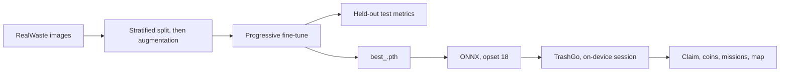

# TrashGo

**On-device landfill waste classification, and the benchmark behind it.**

TrashGo is one project in two parts. **ViT-RealWaste** is the research: a leakage-aware comparison of a Vision Transformer (ViT-B/16) against three CNNs on the [RealWaste](https://github.com/sam-single/realwaste) dataset. **TrashGo** is the product: a Flutter app that runs an ONNX export of that pipeline entirely on the phone and turns a correct classification into a claim, coins and missions.

| | |
| --- | --- |
| Author | Djoud El Hak Belkhir ([djoudelhak@gmail.com](mailto:djoudelhak@gmail.com)) |
| Research | ViT-RealWaste — manuscript, 2026 |
| Application | TrashGo — Flutter, on-device ONNX Runtime |
| Data | RealWaste, Single, Iranmanesh & Raad, 2023 |

There is no web front end in the research notebook. The notebook is the training and export pipeline. The mobile app is the end-user interface.

---

## Contents

- [How the two parts fit](#how-the-two-parts-fit)
- [Repository layout](#repository-layout)
- [Part I — ViT-RealWaste](#part-i--vit-realwaste)
  - [Question](#question)
  - [Headline results](#headline-results)
  - [Dataset](#dataset)
  - [Protocol](#protocol)
  - [Model configuration](#model-configuration)
  - [Reproducing the benchmark](#reproducing-the-benchmark)
  - [ONNX export and inference](#onnx-export-and-inference)
  - [Limitations](#limitations)
  - [Known issues](#known-issues-in-the-notebook)
- [Part II — TrashGo](#part-ii--trashgo)
  - [Architecture](#architecture)
  - [Stack](#stack)
  - [Model integration](#model-integration)
  - [Claiming flow](#claiming-flow)
  - [Anti-cheat](#anti-cheat)
  - [Reward system](#reward-system)
  - [Setup](#setup)
- [Shared contract](#shared-contract)
- [Citation](#citation)
- [Licence](#licence)
- [Acknowledgements](#acknowledgements)

---

## How the two parts fit



The published comparison is ViT-B/16, VGG-16, MobileNetV2 and Inception V3. The app currently ships the **DenseNet121** export (`densenet_waste.onnx`), because that is the checkpoint the notebook runs through ONNX checker and ONNX Runtime. DenseNet121 is **not** in the paper table. Swapping in another export is safe only if input size, preprocessing and class order stay identical to that model’s evaluation path.

---

## Repository layout

```text
.
├── notebooks/
│   └── realwaste-pipeline.ipynb    # full training, eval and ONNX export
├── results/
│   ├── test_results_summary.csv    # accuracy and macro-F1 per model
│   ├── test_metrics_<model>.csv    # per-class precision, recall, F1
│   ├── confusion_matrix_<model>.png
│   └── model_comparison_chart.png
├── paper/
│   ├── ViT_RealWaste_Belkhir.pdf
│   └── source/                     # .tex and figures
├── models/                         # best_<model>.pth and *.onnx (not in git)
├── TrashGo/                        # Flutter application
│   ├── lib/
│   │   ├── core/                   # theme, routing, constants, errors
│   │   ├── features/
│   │   │   ├── auth/               # Firebase Auth: email/password + Google
│   │   │   ├── claiming/           # camera, on-device ONNX, result
│   │   │   ├── home/               # dashboard, rewards, missions preview
│   │   │   ├── claim_map/          # OSM pins, heat zones, impact stats
│   │   │   ├── missions/           # daily, weekly, special, seasonal
│   │   │   ├── social/             # friends, activity feed, leaderboard
│   │   │   └── profile/            # stats, badges, edit profile, sign out
│   │   └── shared/                 # widgets, Cloudinary service
│   ├── assets/
│   │   ├── models/densenet_waste.onnx
│   │   └── images/icons/           # category icons
│   └── pubspec.yaml
└── README.md
```

---

## Part I — ViT-RealWaste

### Question

Under one identical, leakage-aware protocol, does ViT-B/16 beat representative CNNs on RealWaste, and by how much relative to sampling noise?

### Headline results

Test set: 481 held-out images, 9 classes, one run per model (seed 42). Brackets are 95% bootstrap intervals.

| Model | Accuracy (%) | Macro-F1 (%) | Params | Train time |
| --- | --- | --- | --- | --- |
| MobileNetV2 | 88.57 [85.7, 91.3] | 88.80 [85.8, 91.5] | 2.2 M | 17.3 min |
| VGG-16 | 90.85 [88.2, 93.4] | 91.47 [88.8, 93.8] | 134.3 M | 25.4 min |
| Inception V3 | 93.35 [91.1, 95.4] | 93.59 [91.2, 95.7] | 21.8 M | 31.7 min |
| **ViT-B/16** | **93.35** [91.1, 95.4] | **93.86** [91.5, 95.9] | 85.8 M | 69.5 min |

ViT-B/16 has the best macro-F1 and ties Inception V3 on accuracy. The intervals overlap almost completely, so the two cannot be ranked on 481 images. The same errors — Miscellaneous Trash, Metal and Plastic — recur in every model, which points to label ambiguity rather than architecture as the main bottleneck.

These numbers are not comparable with other published RealWaste results. Those use different splits and protocols.

### Dataset

RealWaste was created by **Sam Single, Saeid Iranmanesh and Raad Raad** (School of Electrical, Computer and Telecommunications Engineering, University of Wollongong, Australia). Images were captured during the biannual residential waste audit at the Whyte's Gully Waste and Resource Recovery Centre in Wollongong, NSW, at 524×524 pixels.

Nine classes: Cardboard, Food Organics, Glass, Metal, Miscellaneous Trash, Paper, Plastic, Textile Trash, Vegetation.

- Paper: S. Single, S. Iranmanesh, R. Raad, “RealWaste: A novel real-life data set for landfill waste classification using deep learning”, *Information*, 14(12), 633, 2023. [doi:10.3390/info14120633](https://doi.org/10.3390/info14120633)
- Data: [github.com/sam-single/realwaste](https://github.com/sam-single/realwaste) (also UCI ML Repository and IEEE DataPort)
- Public release used here: **4,752 images**

Credit the original authors whenever the data or a model trained on it is used. See [Licence](#licence).

### Protocol

Splitting happens **before** augmentation, so an augmented copy of an image never crosses the train / validation / test boundary.

| Phase | What happens |
| --- | --- |
| P1 Split | Per-class stratified 80/10/10 (seed 42): 3,798 / 473 / 481 original images |
| P2 Augmentation | Offline (Augmentor, after the split): train ×3, val ×2, test untouched. Online: random resized crop, flip, rotation, colour jitter, random erasing |
| P3 Init | ImageNet-1K weights, new 9-way head. 224 px (299 px for Inception V3) |
| P4 Optim | Class-weighted cross-entropy (w = 1/n), AdamW (lr 1e-4, weight decay 1e-2), mixed precision, ReduceLROnPlateau |
| P5 Fine-tune | 3 stages × 5 epochs, unfreezing by parameter-tensor index |
| P6 Select | Weighted F1 on the validation set; best epoch is checkpointed |
| P7 Test | Accuracy, macro-F1, per-class metrics, confusion matrix on the untouched test set |

Seeds are fixed to 42 for Python, NumPy, PyTorch and CUDA, with deterministic cuDNN. Results are a single run per model. Expect variation across seeds and hardware.

### Model configuration

`MODEL_CONFIG` in the notebook. Freeze points are parameter-tensor indices: tensors with index ≥ the freeze point are trainable. For ViT-B/16 and VGG-16 that means 96–99% of the network is already trainable in stage 1.

| Model | Input | Freeze points (stage 1 / 2 / 3) | Batch size |
| --- | --- | --- | --- |
| ViT-B/16 | 224 | 10 / 5 / 0 | 32 |
| VGG-16 | 224 | 11 / 5 / 0 | 32 |
| MobileNetV2 | 224 | 149 / 70 / 0 | 32 |
| Inception V3 | 299 | 249 / 120 / 0 | 20 |
| DenseNet121 | 224 | 143 / 80 / 0 | 32 |

A ResNet entry exists in `MODEL_CONFIG` and is never trained. `GradCAM` is imported and unused. DenseNet121 is configured and exported, but its metrics are not in the supplied CSVs and not in the paper comparison.

### Reproducing the benchmark

The notebook was developed on Kaggle with a GPU.

1. Add the RealWaste images as a Kaggle dataset. Set `RAW_PATH` in the constants cell. The folder must contain one sub-folder per class.
2. Install the extra dependencies. PyTorch, torchvision, scikit-learn, pandas, seaborn and wandb are assumed present.

   ```bash
   pip install Augmentor grad_cam onnx onnxscript onnxruntime
   ```

3. Run the notebook top to bottom. The main loop trains each entry of `models_to_try`, evaluates it on the test set and appends `test_results_summary.csv`. The best checkpoint of each model is `best_<model>.pth`.
4. Per model: `test_metrics_<model>.csv` and `confusion_matrix_<model>.png`. At the end: `model_comparison_chart.png`.

### ONNX export and inference

`export_onnx_and_latency(model_name)` loads `best_<model>.pth`, writes `best_<model>.onnx` (opset 18, dynamic batch axis) and reports average PyTorch forward latency over 100 runs. The notebook also exports a DenseNet121 checkpoint, validates it with `onnx.checker`, and runs it in ONNX Runtime on a downloaded test image.

No ONNX Runtime latency numbers are reported for the four models in the paper.

Preprocess **exactly as at evaluation time**, then apply a softmax. Do not use `Resize((224, 224))`, and do not treat the max logit as a confidence.

```python
import numpy as np
import onnxruntime as ort
from PIL import Image
import torchvision.transforms as T

tf = T.Compose([
    T.Resize(256),
    T.CenterCrop(224),
    T.ToTensor(),
    T.Normalize([0.485, 0.456, 0.406], [0.229, 0.224, 0.225]),
])
x = tf(Image.open("item.jpg").convert("RGB")).unsqueeze(0).numpy().astype(np.float32)

sess = ort.InferenceSession("best_vit.onnx")
logits = sess.run(None, {"input": x})[0][0]
probs = np.exp(logits - logits.max())
probs /= probs.sum()

labels = [
    "Cardboard", "Food Organics", "Glass", "Metal", "Miscellaneous Trash",
    "Paper", "Plastic", "Textile Trash", "Vegetation",
]
print(labels[int(probs.argmax())], float(probs.max()))
```

Inception V3 uses 299 px: resize to 320, then centre-crop to 299.

The class list above is the alphabetical folder order that `flow_from_directory` produces unless `classes=` is overridden. Confirm it after training:

```python
import json
gen = ImageDataGenerator().flow_from_directory(TRAIN_PATH)
print(sorted(gen.class_indices.items(), key=lambda x: x[1]))
```

### Limitations

Single random split and a single seed per model. No group-aware split, so photos of the same item can land in different partitions. The validation set contains offline-augmented copies. Confidence intervals are marginal and ignore training variance. The paper discusses these in full.

### Known issues in the notebook

Fix these before treating a notebook cell as the deployment path. The canonical preprocessing and probability are the ones in [ONNX export and inference](#onnx-export-and-inference) and in the app.

| Issue | What is wrong | What to use instead |
| --- | --- | --- |
| Demo preprocess | An inference cell uses `Resize((224, 224))` | `Resize(256)` then `CenterCrop(224)`, as in evaluation |
| “Confidence” | The demo prints `max(logits)` | Softmax; report `max(probs)` |
| Reload print | The reload cell prints `Using best model: densnet` for every `best_model_name` | Print `best_model_name` |
| DenseNet121 | Trained/exported in the notebook, absent from the paper CSVs | Do not cite it as a paper result |
| Dead config | `GradCAM` is unused; a ResNet entry in `MODEL_CONFIG` is never trained | Remove or wire them; do not assume they ran |

---

## Part II — TrashGo

TrashGo is the end-user application. Classification runs fully offline through ONNX Runtime. The network is used for accounts, claims, photos and social features — never for the forward pass.

### Architecture

```text
TrashGo/
├── lib/
│   ├── core/                 # theme, routing, constants, error types
│   ├── features/
│   │   ├── auth/             # Firebase Auth (email/password + Google)
│   │   ├── claiming/         # camera, on-device ONNX, result screen
│   │   ├── home/             # dashboard, rewards carousel, missions preview
│   │   ├── claim_map/        # OpenStreetMap pins, heat zones, impact stats
│   │   ├── missions/         # daily / weekly / special / seasonal quests
│   │   ├── social/           # friends, activity feed, leaderboard
│   │   └── profile/          # stats, badges, edit profile, sign out
│   └── shared/               # reusable widgets, Cloudinary service
├── assets/
│   ├── models/densenet_waste.onnx
│   └── images/icons/
└── pubspec.yaml
```

### Stack

| Layer | Technology |
| --- | --- |
| Framework | Flutter 3.29+ / Dart 3.7+ |
| State | Riverpod 2.x |
| Navigation | GoRouter 14 |
| Backend | Firebase Auth and Firestore (Spark plan is enough to start) |
| Inference | ONNX Runtime v2 (`onnxruntime_v2`), CPU delegate |
| Maps | `flutter_map` + OpenStreetMap (no map billing) |
| Photos | Cloudinary, free tier |

Inference target: under 800 ms on a mid-range Android phone. Measured on a Xiaomi Redmi Note 11.

### Model integration

Export from the notebook, then rename:

```bash
# inside the notebook
export_onnx_and_latency("DenseNet121")   # writes best_densenet121.onnx

# into the app
cp best_densenet121.onnx TrashGo/assets/models/densenet_waste.onnx
```

The session input is `float32` with shape `[1, 3, 224, 224]` in **NCHW**. Preprocessing lives in `OnnxInferenceService._preprocessImage()` and must match evaluation:

1. Resize so the shorter side is 256 px.
2. Centre-crop to 224×224.
3. Scale to `[0, 1]`.
4. Normalize with mean `[0.485, 0.456, 0.406]` and std `[0.229, 0.224, 0.225]`.
5. Softmax over the 9 logits. Accept a claim only if `max(probs) ≥ 0.65`.

`classIndex` and `modelKey` in `trash_label_map.dart` must be the training `class_indices`, not a hand-sorted guess. A mismatch yields confident, wrong labels.

Display names are UI only. They do not change the index the model was trained with.

| Index | Training class | Name in the app |
| --- | --- | --- |
| 0 | Cardboard | Cardboard |
| 1 | Food Organics | Organic Waste |
| 2 | Glass | Glass Bottle |
| 3 | Metal | Metal Can |
| 4 | Miscellaneous Trash | Misc. Trash |
| 5 | Paper | Paper |
| 6 | Plastic | Plastic Waste |
| 7 | Textile Trash | Textile |
| 8 | Vegetation | Vegetation |

This index column assumes alphabetical folder order. Replace it with the notebook printout if that printout differs.

Inception V3 is not a drop-in replacement: it expects a 299 px crop (resize 320, centre-crop 299) and a different batch size at training time. Any other checkpoint needs the same three-way check — spatial size, normalisation, class order — before it replaces `densenet_waste.onnx`.

### Claiming flow

```text
User taps CLAIM
  → full-screen camera, live preview
  → SNAP
  → preprocess to float32 [1, 3, 224, 224]
  → OrtSession on device
  → softmax → argmax → confidence ≥ 0.65
  → if accepted:
        Firestore batch (atomic): claim, coins, stars, score
        mission progress incremented
        photo upload to Cloudinary in the background (does not block the reward)
  → if rejected:
        "That doesn't look like trash" — nothing is awarded
```

### Anti-cheat

- **Duplicate photo.** SHA-256 of the image bytes. A repeated hash is not a new claim.
- **Teleport claims.** Consecutive claims must be at least 50 m apart, Haversine distance.

### Reward system

Base coins scale with how common the category is, so the incentive points at litter that is rarer in the audit mix rather than at the easiest photos.

| Rarity | Examples | Base coins |
| --- | --- | --- |
| Common | Paper, Cardboard, Organic | 20–25 |
| Uncommon | Glass, Metal, Plastic bag | 40–50 |
| Rare | Misc. plastic, Cigarette | 55–60 |
| Epic | E-waste, Hazardous | 80–100 |

Bonuses, applied on top of the base amount:

| Bonus | Condition |
| --- | --- |
| +50% | First claim of the day |
| +25% | Streak of at least 3 days |
| +50% cumulative | Streak of at least 7 days |

The classifier only emits the nine RealWaste classes. Cigarette, e-waste and hazardous appear here as product tiers. They are not separate heads in the current model, so they cannot be awarded unless a later label set or an explicit mapping from Miscellaneous Trash defines them. Do not describe the shipped ONNX file as detecting those categories.

### Setup

Prerequisites: Flutter 3.29+, Android SDK API 24+, a Firebase project, a Cloudinary account.

```bash
# 1. Model
cp best_densenet121.onnx TrashGo/assets/models/densenet_waste.onnx

# 2. Dependencies
cd TrashGo && flutter pub get

# 3. Firebase — writes lib/firebase_options.dart
flutterfire configure

# 4. Cloudinary, in lib/shared/services/cloudinary_service.dart
#    _cloudName    = 'your_cloud_name'
#    _uploadPreset = 'trashgo_claims'

# 5. Run
flutter run
```

Release APK, one file per ABI:

```bash
flutter build apk --release --split-per-abi
# build/app/outputs/flutter-apk/app-arm64-v8a-release.apk
```

---

## Shared contract

Anything that crosses from the notebook into the app has to satisfy all of the following. If one line changes, the others change with it.

| Item | Value |
| --- | --- |
| Shipped weights | `best_densenet121.onnx` → `TrashGo/assets/models/densenet_waste.onnx` |
| Paper models | ViT-B/16, VGG-16, MobileNetV2, Inception V3 (DenseNet121 is export-only) |
| Input | NCHW `float32`, batch 1, 3×224×224 (299 for Inception V3) |
| Preprocess | Resize 256 → centre crop 224 → ImageNet mean/std |
| Head | 9 logits, training class order, softmax before any threshold |
| Accept | confidence ≥ 0.65 |
| Reject copy | “That doesn't look like trash” — no coins |
| Split rule | split first, augment second; test set is never augmented |

---

## Citation

```bibtex
@misc{belkhir2026vitrealwaste,
  author = {Belkhir, Djoud El Hak},
  title  = {ViT-RealWaste: A Leakage-Aware Benchmark of a Vision Transformer against CNNs for Landfill Waste Classification},
  year   = {2026},
  note   = {Manuscript}
}

@article{single2023realwaste,
  author  = {Single, Sam and Iranmanesh, Saeid and Raad, Raad},
  title   = {RealWaste: A Novel Real-Life Data Set for Landfill Waste Classification Using Deep Learning},
  journal = {Information},
  volume  = {14},
  number  = {12},
  pages   = {633},
  year    = {2023},
  doi     = {10.3390/info14120633}
}
```

---

## Licence

RealWaste’s terms are not uniform across mirrors. UCI lists CC BY 4.0. The paper and IEEE DataPort list **CC BY-NC-SA 4.0**. Follow the stricter terms: attribution, non-commercial use, and share-alike.

That constraint covers the images and models trained on them, including `densenet_waste.onnx` inside TrashGo. A commercial release needs a separate grant from the dataset authors. This repository does not relicense their data.

Code licence for the notebook, paper source and TrashGo application: add one here when you choose it. Until then, do not assume the code is open for reuse.

---

## Acknowledgements

Thanks to Sam Single, Saeid Iranmanesh and Raad Raad (University of Wollongong) for creating and releasing RealWaste. The benchmark and the app both depend on that dataset.
